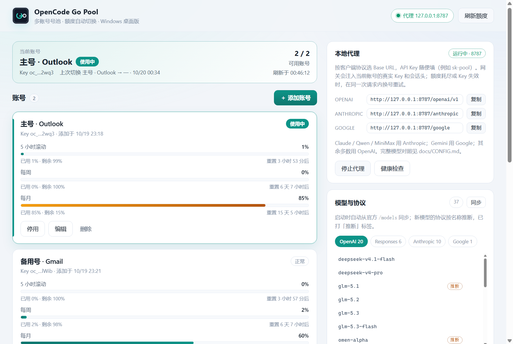

# OpenCode Go Pool · Windows 桌面版

把多个 **OpenCode Go** 账号做成一个号池：三个额度窗口一眼看全，托盘/快捷键一键换号，额度耗尽或 Key 失效时自动切换；内置本地 OpenAI 兼容代理，任何客户端把 Base URL 指过来就能用整个号池。

> 这是独立桌面应用（Electron），与 `dsh-opencode-go` 这个 DSH 插件是两套实现：
> 插件负责接管 DSH 内部的 `opencode-go` 路由；本应用面向任意客户端（OpenCode、Cherry Studio、脚本、OpenAI SDK…），两边账号互不影响，也可以同时使用。



## 功能

| 功能 | 说明 |
|---|---|
| 🗂 多账号号池 | 每个账号保存一个 OpenCode Go Key，独立记录 5 小时滚动 / 每周 / 每月额度 |
| 📊 额度看板 | 三条用量进度条 + 重置倒计时，30 秒自动刷新（可调） |
| 🔁 自动切号 | 额度耗尽、Key 失效立即切换；限流/5xx/网络错误按「连续失败 N 次」切换 |
| 🎯 主动避让 | 任一额度窗口达到阈值就提前换号，不必等请求失败（默认 95%，可设 100 关闭） |
| 🧭 模型目录 | 启动时自动从官方 `/models` 同步；老模型按 pi-ai 目录分类，新模型按名称推断协议并标「推断」，每 6 小时自动刷新 |
| 🌐 本地代理 | 四种协议原样转发：`/openai/v1`、`/anthropic`、`/google`；自动注入 Key 和 `x-opencode-session`，同请求内换号重试，SSE 流式透传 |
| 🖱 托盘 + 快捷键 | 托盘菜单直接选账号；`Ctrl + Alt + O` 切到下一个可用账号；`Ctrl + Alt + Shift + O` 打开面板 |
| 🔐 本地加密 | 密钥用 Windows DPAPI（Electron `safeStorage`）加密，只存本机；界面永远拿不到明文 |
| 🪟 原生体验 | 关闭窗口隐藏到托盘、开机自启（安装版）、Windows 通知、单实例 |

## 安装

构建产物在 `dist/`：

- `OpenCodeGoPool-1.0.0-setup.exe` —— NSIS 安装版（推荐，支持开机自启、开始菜单/桌面快捷方式）
- `OpenCodeGoPool-1.0.0-portable.exe` —— 便携版，双击即用（不支持开机自启）

未签名应用首次运行会被 SmartScreen 拦一下：点「更多信息」→「仍要运行」。

### 如果双击后立即闪退

Chromium 的沙箱**不能在「以管理员身份运行」的进程里初始化**（会直接闪退，没有任何提示）。这种情况用同目录下的 `启动-兼容模式.cmd`，它会带 `--no-sandbox` 启动：

```
"OpenCode Go Pool.exe" --no-sandbox
```

从普通桌面（非管理员终端）双击则不需要这个参数。

## 第一次使用

1. 点「添加账号」，填显示名，粘贴 OpenCode Go 的 API Key（`sk-...`）。
2. 打开「设置 → 模型」里的额度页确认用量条出现（401 表示 Key 无效）。
3. 在客户端里填：

```text
Base URL: http://127.0.0.1:8787/openai/v1
API Key:  sk-pool
```

OpenAI SDK 示例：

```python
from openai import OpenAI
client = OpenAI(base_url="http://127.0.0.1:8787/openai/v1", api_key="sk-pool")
```

Claude Code / Codex / ZCode / DSH 的完整配置见 **[docs/CONFIG.md](docs/CONFIG.md)**。

`OPENAI_BASE_URL` / `OPENAI_API_KEY` 环境变量指向同样的值即可。

## 切号规则

- **额度耗尽 / Key 失效（QUOTA / 401 / 403 / 402）**：立即标记并切换，下一次请求落到新账号。
- **主动避让**：5 小时、每周、每月任一窗口 `percent >= preemptAtPercent` 时跳过该账号；默认 95。设为 100 表示只在失败后切。
- **连续失败**：限流、5xx、网络错误累计 N 次后切换（默认 2，0 = 关闭）。
- **自动复活**：额度接口报告所有窗口都恢复且低于 98% 时，耗尽的账号自动回到池中。
- 所有账号都不可用时，代理返回 `503` 和明确的错误信息，面板会全红提示。

## 本地代理

绑定 `127.0.0.1`（仅本机），按 OpenCode Go 的原生协议原样转发：

| 路径 | 用途 |
|---|---|
| `/openai/v1/*` | OpenAI Chat 组（18）+ Responses 组（5） |
| `/anthropic/*` | Anthropic Messages 组：Claude、Qwen、MiniMax |
| `/google/*` | Google Generative AI 组：Gemini 4 Argon |
| `/v1/*` | 兼容别名，等价于 OpenAI Chat 组 |
| `/inference/go/*` | 原始透传（给自定义路径的客户端） |

网关自动注入 `Authorization`、`x-api-key` / `x-goog-api-key`（按协议）和 `x-opencode-session`；客户端不需要自己处理会话头。区域限制（例如 GPT/Grok 的 403）原样透传，不会把账号标失效。

完整的四种客户端配置、模型清单和排错表：[docs/CONFIG.md](docs/CONFIG.md)。

## 数据与安全

- 数据文件：`%APPDATA%\OpenCode Go Pool\pool.json`
- 密钥：`safeStorage.encryptString` → Windows DPAPI，绑定当前 Windows 用户；换用户/换机器无法解密。
- 渲染进程拿不到明文密钥，也不能联网（CSP `connect-src 'none'`），只能通过 IPC 操作主进程。
- 代理只监听回环地址，不对外网开放。
- 额度接口：`https://opencode.ai/zen/go/v1/usage`（非公开文档接口，解析是防御式的，接口形状变化只会让进度条报错，不影响切号）。

## 开发

```powershell
pnpm install                              # 安装 Electron 与打包工具
node --test test/*.test.mjs               # 44 项核心逻辑/代理测试（不启动 GUI）
pnpm start                                # 开发运行
powershell -NoProfile -ExecutionPolicy Bypass -File scripts/build.ps1
```

`scripts/build.ps1` 会复用 `node_modules/electron/dist`、跳过代码签名（`signExecutable=false`，免下载签名工具），并在 `dist/` 生成安装版与便携版。只构建未打包目录用 `-Dir`。

构建环境如果没把 pnpm 放进 PATH，脚本会在 `%TEMP%` 里生成一个临时 shim 给 electron-builder 的依赖收集器用（可用 `PNPM_MJS` 指定 pnpm 入口）。

调试用的环境变量：

- `POOL_DATA_DIR` —— 覆盖数据目录（隔离测试）
- `POOL_USAGE_BASE_URL` —— 覆盖额度接口地址（本地 mock）
- `--smoke-test` —— 启动后截屏、检查代理、退出（用于 CI/打包验证）

## 已知限制

- **未签名**：首次运行会被 SmartScreen 提示；介意的话可以在自己的机器上禁用提示或用安装版。
- **管理员会话闪退**：见上文「如果双击后立即闪退」，用 `启动-兼容模式.cmd`（安装版会在安装目录生成）。
- **便携版不支持开机自启**：`app.setLoginItemSettings` 指向临时解压目录，便携版里已主动跳过；需要自启用安装版。
- 托盘图标在无交互桌面的会话（例如纯服务/无 RDP 会话）无法创建，应用仍可通过窗口使用。
- 只做号池与代理，不改系统代理、不接管其他应用的配置；客户端需要手动填写 Base URL。

## 目录

```text
electron/
  main.cjs            Electron 主进程：窗口、托盘、快捷键、通知、IPC
  preload.cjs         contextBridge 白名单
  core/
    store.js          加密存储、账号 CRUD、状态归一化
    pool.js           号池状态机（纯逻辑）
    usage.js          额度接口客户端
    proxy.js          本地 OpenAI 兼容代理（流式 + 换号重试）
    failures.js       上游状态码 → 失败分类
    controller.js     存储/号池/轮询/代理编排
renderer/             原生 DOM 界面（无构建步骤）
test/                 node:test 单元测试 + 代理集成测试
```
