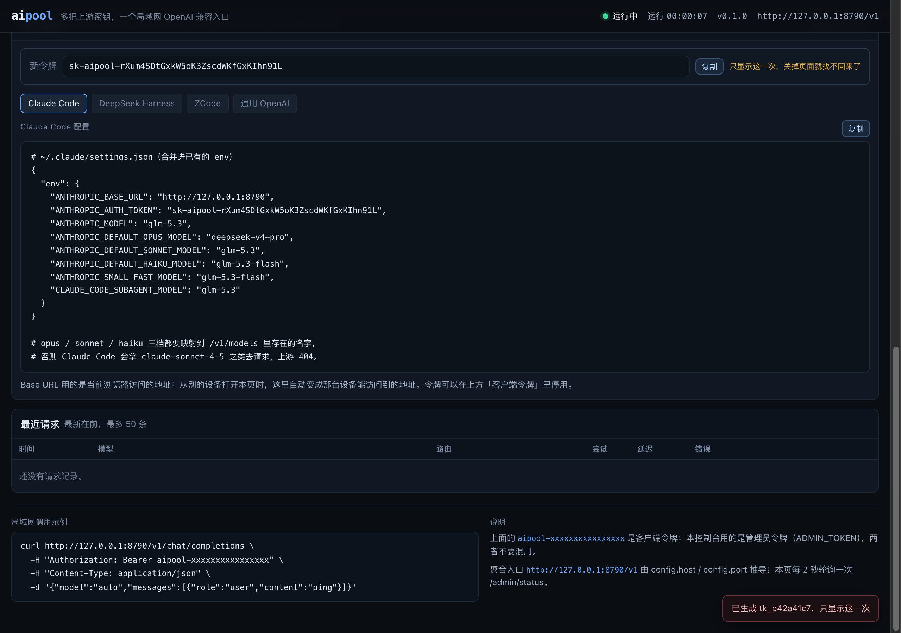

# 客户端接入

aipool 同时说两种协议，所以基本所有 AI 编程工具都能接：

| 客户端协议 | aipool 地址 | 用在哪 |
|---|---|---|
| OpenAI Chat Completions | `http://<host>:8790/v1` | Cursor、Continue、opencode、任何 OpenAI SDK、脚本 |
| Anthropic Messages | `http://<host>:8790`（自动走 `/v1/messages`） | Claude Code、ZCode、DSH、任何 Anthropic SDK |

凭证是 **客户端 token**（`sk-aipool-…`），不是 admin token。每台设备建议单独发一个：

```bash
aipool token new --name claude-code
aipool token new --name zcode
```

模型名用 `/v1/models` 里的任一 id（裸 id 或 `provider/model`），例如 `glm-5.3`、`deepseek-v4-pro`、`kimi-k3`。

---

## 面板里直接抄

打开 `http://<host>:8790/?token=<admin token>`，滚到 **「客户端接入」**：

- 四个标签页：Claude Code / DeepSeek Harness / ZCode / 通用 OpenAI，内容按当前访问地址自动生成
- 每段配置右上角有「复制」
- 「生成客户端令牌」会现场签发一个 `sk-aipool-…`（只显示这一次），签完指南里的 token 自动替换成它



## 1. Claude Code（本机已配置并通过实测）

Claude Code 读 `~/.claude/settings.json` 的 `env`。改完这些就行：

```json
{
  "env": {
    "ANTHROPIC_BASE_URL": "http://127.0.0.1:8790",
    "ANTHROPIC_AUTH_TOKEN": "sk-aipool-…",
    "ANTHROPIC_MODEL": "glm-5.3",
    "ANTHROPIC_DEFAULT_OPUS_MODEL": "deepseek-v4-pro",
    "ANTHROPIC_DEFAULT_SONNET_MODEL": "glm-5.3",
    "ANTHROPIC_DEFAULT_HAIKU_MODEL": "glm-5.3-flash",
    "ANTHROPIC_SMALL_FAST_MODEL": "glm-5.3-flash",
    "CLAUDE_CODE_SUBAGENT_MODEL": "glm-5.3"
  }
}
```

要点：

- **模型名必须映射**：Claude Code 默认会请求 `claude-sonnet-4-5` 这类名字，aipool 的上游没有。用 `ANTHROPIC_DEFAULT_*_MODEL` 把 opus/sonnet/haiku 三档都指到真实模型上。
- `ANTHROPIC_AUTH_TOKEN` 会以 `Authorization: Bearer` 发送，aipool 两种头都认。
- 流式与工具调用都已打通（Anthropic 入站 → OpenAI 上游），实测 `claude -p "用 Bash 跑 echo …"` 能正常执行并回传。

改完不用重启，新开会话即生效：

```bash
claude -p "只回复四个字：连接成功"
```

> 修改前的配置在 `~/.claude/settings.json.bak-aipool`。

---

## 2. DeepSeek Harness（DSH）

DSH 通过 `llm-pi-ai` 插件声明供应商。在 `~/.dsh/profiles/desktop/cordis.patch.yml` 的 `llm-pi-ai.config.providers` 下加一段：

```yaml
      aipool:
        displayName: aipool (LAN)
        apiKeyEnv: AIPOOL_CLIENT_TOKEN
        api: openai-completions
        baseURL: http://127.0.0.1:8790/v1
        models:
          - id: glm-5.3
            name: GLM 5.3 (aipool)
            contextWindow: 1024000
            maxTokens: 128000
            input:
              - text
```

再把 token 写进 `~/.dsh/.credentials.yaml` 的 `refs`：

```yaml
refs:
  AIPOOL_CLIENT_TOKEN: sk-aipool-…
```

然后**重启 DSH**（这台机器上已经写好了上面两段，只差重启）。重启后「设置 → 模型」里会多出 aipool 供应商和它的模型。

> 本机修改前备份：`cordis.patch.yml.bak-aipool-*`、`.credentials.yaml.bak-aipool-*`。
> 注意：DSH 重启会结束当前这个会话。

为什么用 `api: openai-completions` 而不是 `anthropic-messages`：两条都能用，但 OpenAI 兼容路径在 pi-ai 里对工具调用/流式的处理最成熟；接入 Anthropic 协议的上游由 aipool 负责翻译。

---

## 3. ZCode

ZCode（智谱的 AI 代码编辑器）把供应商配置保存在 `~/.zcode/v2/` 下，**运行时会把自己的内存状态写回文件**，所以必须先完全退出（Cmd-Q，不是关窗口）。

### 方式 A：脚本（推荐）

```bash
# 1. 退出 ZCode
# 2. 注册供应商
node ~/Documents/Jem/aipool/scripts/connect-zcode.mjs \
  --token sk-aipool-… \
  --base http://127.0.0.1:8790
# 3. 重新打开 ZCode，在模型/供应商里选 “aipool (LAN)”
```

脚本是幂等的，会先备份 `provider_config.json` / `config.json`，支持 `--dry-run` 预览、`--models` 自定义模型列表。

### 方式 B：界面里手填

ZCode → 设置 → 模型服务 → 添加自定义供应商：

| 字段 | 值 |
|---|---|
| 协议 / API 类型 | Anthropic Messages |
| Base URL | `http://127.0.0.1:8790` |
| API Key | `sk-aipool-…` |
| 模型 | `glm-5.3`、`deepseek-v4-pro`、`glm-5.3-flash`、`kimi-k3` |

（用 OpenAI 兼容类型也可以，Base URL 改 `http://127.0.0.1:8790/v1`。）

> ZCode 自己的订阅套餐（`builtin:zai`、coding plan）不受影响，aipool 只是多一个供应商条目。

---

## 4. 其他客户端

### Cursor / Continue / opencode / 任何 OpenAI SDK

```
Base URL: http://<这台机器的局域网 IP>:8790/v1
API Key:  sk-aipool-…
Model:    glm-5.3（或 /v1/models 里任意 id）
```

### 脚本

```bash
curl http://192.168.8.104:8790/v1/chat/completions \
  -H "Authorization: Bearer $AIPOOL_TOKEN" -H 'content-type: application/json' \
  -d '{"model":"glm-5.3","messages":[{"role":"user","content":"hi"}]}'
```

---

## 常见问题

| 现象 | 原因 / 处理 |
|---|---|
| `MODEL_NOT_FOUND` | 上游目录里没有这个 id。`aipool models` 看可用列表；自定义模型写 `provider/model` 也能透传 |
| `NO_USABLE_KEY` | 池里没有可用 Key：`aipool key ls`、`aipool key test` |
| `ALL_KEYS_COOLING` (429) | 所有 Key 都在冷却，响应头有 `Retry-After`；面板可以「重置冷却」 |
| Claude Code 报 unknown model | 忘了配 `ANTHROPIC_DEFAULT_*_MODEL` 映射 |
| ZCode 里看不到 aipool | 写配置时 ZCode 没退出，被回写覆盖；退出后重跑脚本 |
| DSH 里没有 aipool | 没重启 DSH，或 `cordis.patch.yml` 缩进不对（`aipool:` 与 `opencode-go:` 同级，6 空格） |
